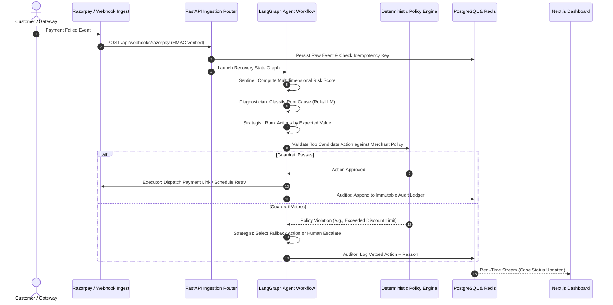
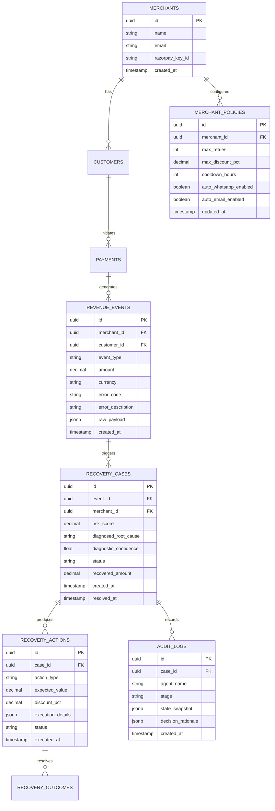

# System Architecture Document — REVIVE
## Revenue Recovery Intelligence & Value Engine

**Version:** 1.0.0  
**Status:** Approved for Implementation  
**Target Environment:** Local Docker Compose / Cloud Ready  

---

## 1. High-Level Architecture Overview

REVIVE uses a **hybrid micro-service architecture** that decouples user interaction, asynchronous event processing, deterministic policy governance, and cognitive AI reasoning.

```
                      ┌────────────────────────────────────────┐
                      │          Next.js 14 Frontend           │
                      │  (TypeScript, Tailwind, shadcn, Recharts)│
                      │               Port: 3000               │
                      └───────────────────┬────────────────────┘
                                          │
                                   REST / WebSocket
                                          │
                                          ▼
                      ┌────────────────────────────────────────┐
                      │          FastAPI Backend Core          │
                      │    (Python 3.11, Pydantic, SQLAlchemy)  │
                      │               Port: 8000               │
                      └───────┬───────────┬────────────┬───────┘
                              │           │            │
            ┌─────────────────┘           │            └──────────────────┐
            ▼                             ▼                               ▼
┌───────────────────────┐   ┌───────────────────────────┐   ┌───────────────────────────┐
│ PostgreSQL 16 (Relational)│   │       Redis 7 (Cache)     │   │   Ollama Local LLM (Opt)  │
│ - Events & Cases      │   │ - Idempotency Locks       │   │ - Qwen2.5 / Llama3       │
│ - Merchant Policies   │   │ - Fast Risk Queues        │   │ - Port: 11434             │
│ - Immutable Audit Logs│   │ - Pub/Sub Event Broadcast │   │ - Fallback to Rule Engine │
│ Port: 5432            │   │ Port: 6379                │   │                           │
└───────────────────────┘   └───────────────────────────┘   └───────────────────────────┘
```

---

## 2. Component Breakdown

### 2.1 Next.js 14 Web Application
- **Server/Client Hybrid:** Utilizes Next.js App Router for server-rendered dashboards and dynamic client-side state for the batch simulator.
- **Real-Time Polling & WebSockets:** Subscribes to case updates and simulation batch streams to animate funnels in real-time.
- **Client-Side Simulation Cache:** Maintains local filtering for rapid tabular sorting without saturating backend DB.

### 2.2 FastAPI Backend Core
- **Async API Router:** Manages endpoints for events, risk, cases, policies, simulations, and audit logs.
- **LangGraph Multi-Agent Orchestrator:** Manages execution graph state across the 5 agents (`Sentinel`, `Diagnostician`, `Strategist`, `Executor`, `Auditor`).
- **Deterministic Policy Guardrail Engine:** A standalone, non-LLM validation gate that evaluates merchant-defined rules prior to dispatch.
- **Synthetic Simulator Engine:** High-performance vectorized generator producing realistic payment failure scenarios at scale ($>500\text{ records/sec}$).
- **Razorpay Integration Gateway:** Verifies HMAC-SHA256 signatures on incoming webhooks and interfaces with Razorpay Test Mode REST API.

### 2.3 Storage Layer
- **PostgreSQL 16:** ACID-compliant relational persistence with indexed queries on `merchant_id`, `created_at`, `status`, and `risk_score`.
- **Alembic:** Database migrations for deterministic schema provisioning.
- **Redis 7:** In-memory queue for task scheduling, rate limiting, distributed lock management, and real-time metric counters.

---

## 3. End-to-End Data Flow



---

## 4. Database Schema & Data Models

### 4.1 Entity Relationship Diagram



---

## 5. API Specification & Route Inventory

| Route | Method | Description |
|---|---|---|
| `/health` | `GET` | Health status of backend, DB, Redis, and Ollama |
| `/api/events` | `POST` | Ingest arbitrary payment failure event |
| `/api/risk` | `GET` | List at-risk cases filtered by risk score threshold |
| `/api/cases` | `GET` | Query recovery cases with pagination and filters |
| `/api/cases/{id}` | `GET` | Retrieve case detail including full step-by-step decision trace |
| `/api/simulator/run`| `POST` | Trigger synchronous or streamed batch simulation |
| `/api/policies` | `GET` | Fetch active merchant guardrail configuration |
| `/api/policies` | `PUT` | Update merchant guardrail parameters with validation |
| `/api/audit` | `GET` | Query immutable audit log with cryptographic hash checks |
| `/api/metrics` | `GET` | Primary KPI aggregates (ARR at risk, recovered volume, win rate) |
| `/api/experiments` | `GET` | Real-time results of heuristic vs. REVIVE A/B runs |
| `/api/webhooks/razorpay` | `POST` | Razorpay webhook consumer with HMAC signature verification |

---

## 6. Hybrid Reasoning Engine Mechanics

```
                  ┌────────────────────────────────────────┐
                  │    Diagnostician Incoming Payload      │
                  └───────────────────┬────────────────────┘
                                      │
                         Is error_code unequivocally mapped?
                                      │
                     ┌────────────────┴────────────────┐
                     ▼ YES                             ▼ NO / AMBIGUOUS
        ┌──────────────────────────┐     ┌───────────────────────────┐
        │ Instant Deterministic    │     │ Ollama Local LLM Prompt   │
        │ Fast Path (<5ms)         │     │ (Contextual Reasoning)    │
        └────────────┬─────────────┘     └─────────────┬─────────────┘
                     │                                 │
                     └────────────────┬────────────────┘
                                      ▼
                        Standardized Diagnostic Report
```

1. **Deterministic Fast Path:** Evaluates explicit gateway codes (e.g., `BAD_REQUEST_ERROR`, `GATEWAY_ERROR`, `INSUFFICIENT_FUNDS`). If mapped, produces classification instantaneously with zero LLM overhead.
2. **Cognitive Fallback Path:** If Ollama is available, evaluates subtle failure combinations (e.g., recurring mandate halt with low customer engagement).
3. **Graceful Fail-Safe:** If Ollama is down, cognitive fallback seamlessly reverts to rule-based fallback with zero service interruption.
